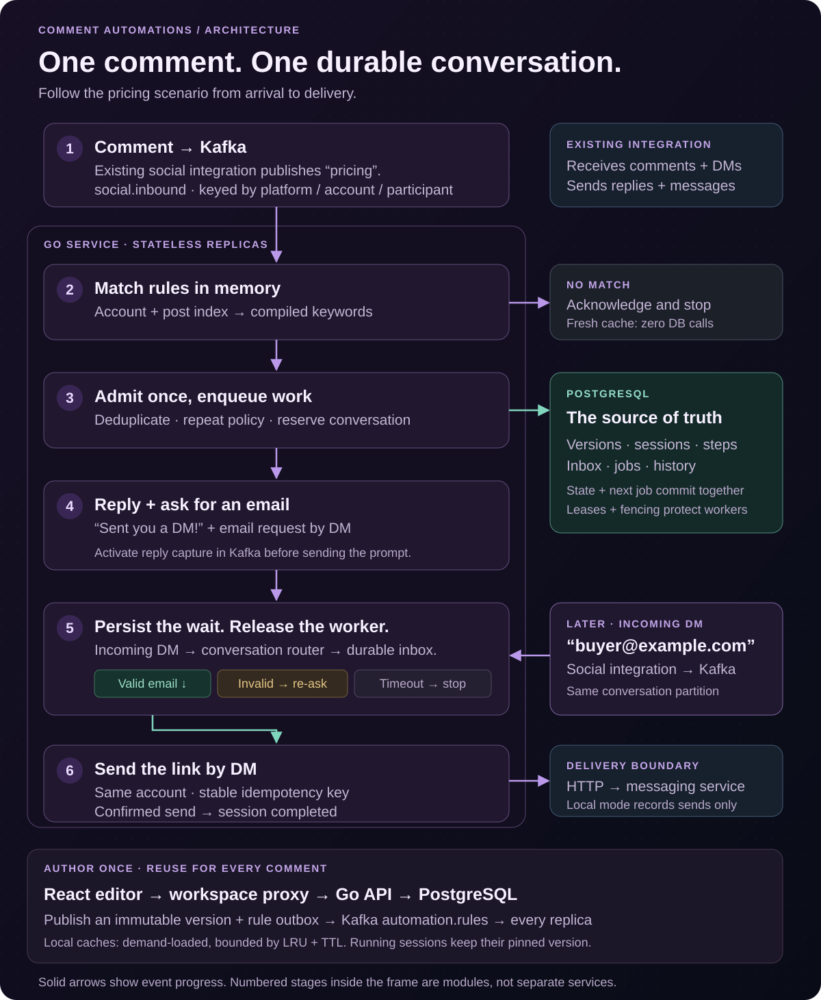
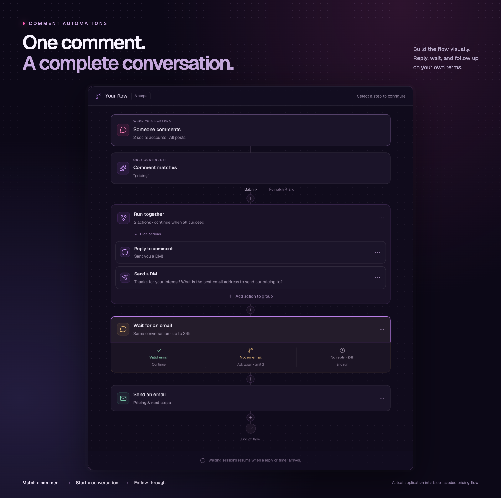

<h1 align="center">Comment Automations</h1>

<p align="center">
  <strong>Turn a social comment into a conversation that follows through.</strong><br>
  A visual workflow builder with fast trigger matching and durable, asynchronous execution.
</p>

<p align="center">
  <a href="#architecture">Architecture</a> ·
  <a href="#build-the-conversation">Explore the flow</a> ·
  <a href="#run-locally">Run locally</a> ·
  <a href="docs/architecture/README.md">Documentation</a>
</p>

<p align="center">
  
  
  
  
</p>

## Architecture

The React editor talks to an internal Go API through a workspace proxy. An existing social integration supplies normalized comments and DMs through Kafka. One Go service contains the API, matcher, conversation router and execution workers; replicas share durable state, not process memory.



<sub>[View full-size diagram](docs/assets/readme/architecture.svg) · [Mermaid source](docs/assets/readme/architecture.mmd) · [Detailed design](docs/architecture/README.md)</sub>

### From a comment to a completed conversation

1. **Receive and match.** The existing social integration publishes a comment to Kafka, keyed by platform/account/participant. The matcher selects account/post rules and evaluates the text in memory. Fresh cached non-matches are acknowledged without database work.
2. **Start once.** A PostgreSQL transaction deduplicates the matching event, enforces repeat policy, reserves the conversation and creates a session plus durable jobs. Kafka is acknowledged after commit.
3. **Reply and ask.** Workers send **“Sent you a DM!”** and a DM requesting an email. Reply capture is activated through the same Kafka partition before the question is sent, so even a very fast answer is retained.
4. **Wait, then resume.** The session sleeps as database records. An incoming DM passes through Kafka and the conversation router into a durable inbox. One valid email advances the wait; an invalid answer triggers a bounded re-ask; expiry stops the run.
5. **Send the link.** A worker sends another **DM on the originating account**, containing the configured link. The session completes only after confirmed delivery.

### Why this design

A small, typed workflow engine covers sequences, parallel actions, reply waits and timers. It supports the same conversation on different social networks without platform-specific graphs. Arbitrary cycles and user code are excluded to keep validation, recovery and resource use predictable. PostgreSQL serves as both state store and job queue: each transition and its next work commit together, without an additional workflow service.

| Decision                                                                                                                                                          | Why it matters                                                                                                                                                                         |
| ----------------------------------------------------------------------------------------------------------------------------------------------------------------- | -------------------------------------------------------------------------------------------------------------------------------------------------------------------------------------- |
| **Match in memory.** Compiled rules are indexed by account and post in bounded local LRU caches.                                                                  | Fresh cached non-matches need no database access in the handler. Idle TTL, freshness deadlines and memory limits keep old posts from filling memory.                                   |
| **Broadcast rule generations.** Publication writes an invalidation outbox in the same transaction as the new version.                                             | Every replica receives changes; periodic reconciliation and freshness deadlines cover missed notifications. Propagation is eventually consistent.                                      |
| **Persist every accepted transition.** Admission, repeat policy and event deduplication are transactional. Workers claim PostgreSQL jobs with leases and fencing. | Duplicate events and competing workers cannot advance the same step twice. Reply waits and timers survive restarts without retaining goroutines.                                       |
| **Activate before asking.** Conversation activation and incoming DMs share the same Kafka partition.                                                              | A cached “no active session” cannot discard a fast reply to a prompt. One active reply-capable session owns each account/participant conversation.                                     |
| **Keep delivery uncertainty explicit.** Logical sends have stable idempotency keys.                                                                               | Retries require the integration's delivery contract. Ambiguous sends remain available for reconciliation; database transactions alone cannot guarantee exactly-once external delivery. |

### Data model

| Records                                  | Relationship and purpose                                                                                  |
| ---------------------------------------- | --------------------------------------------------------------------------------------------------------- |
| `automations` → `automation_versions`    | One editable draft, many immutable published revisions. Each session pins one revision.                   |
| `trigger_bindings` / `trigger_posts`     | Relational account/post indexes select candidates; versioned JSON holds predicates and the workflow.      |
| `automation_sessions` → `session_steps`  | One execution and its steps, captured email, deadlines and progress.                                      |
| `conversation_owners` → `session_inbox`  | One active reply-capable session per account/participant; incoming messages are deduplicated and ordered. |
| `execution_jobs` / `session_transitions` | Durable work with leases, plus an ordered history of committed state changes.                             |
| `account_rule_sets` / `rule_changes`     | Rule generations and the transactional invalidation outbox.                                               |

[Goose migrations](backend/internal/db/migrations) define the schema; [sqlc queries](backend/internal/db/queries) make its access paths explicit. The [matching design](docs/architecture/002-trigger-matching-and-cache.md) and [session model](docs/architecture/003-session-execution-and-dm-routing.md) document indexes, algorithms and concurrency guarantees.

## Build the conversation



Choose the accounts and posts to watch, decide which comments matter, and build what happens next. Automations work across social platforms; each action respects the capabilities of its connected account.

The core scenario is **pricing comment → public reply + email request by DM → wait for an email → DM with a link**. In the builder, use **Send a DM** as the final action and enter the link. The screenshot and seeded draft show an extended variant that sends an email template instead; both use the same executor. The exact DM scenario is covered by a [full-pipeline integration test](backend/internal/integration/pricing_test.go).

| Start with the right comment                                                  | Decide what happens next                                                                       | Let the conversation take its time                                                                 |
| ----------------------------------------------------------------------------- | ---------------------------------------------------------------------------------------------- | -------------------------------------------------------------------------------------------------- |
| All or selected posts, whole words, exact matches, substrings and exclusions. | Public replies, DMs on the originating account, reusable email templates and parallel actions. | Wait for an email or text reply, delay a step, schedule a time, or follow a separate timeout path. |

Save incomplete drafts, test a flow with a virtual clock, and publish when it is ready. Publishing creates an immutable version: editing a template or changing a draft never rewrites a running conversation.

## Run locally

With Docker and Docker Compose installed, run from the repository root:

```sh
docker compose up -d --build --wait
```

Open **[localhost:3000](http://localhost:3000)**. The workspace starts with three email templates, sample social accounts and posts, and the **Pricing → email capture** draft. Publish it in the editor, or create your own flow. Initialization preserves edits and deletions across restarts.

Local delivery records outgoing requests in PostgreSQL; it does not send real DMs or email. The HTTP delivery adapter connects the existing messaging service. The local workspace proxy is fixed to `northstar`; a public deployment needs an authenticated workspace gateway.

[Send a comment and resume the session with a DM →](docs/local-development.md#process-a-comment)

## Explore the code

```text
backend/
  cmd/                   Service entry point
  internal/feature/      Automation, matching, admission, conversations, execution
  internal/db/           Migrations, SQL queries and generated sqlc packages
  internal/integration/  Full API → Kafka → PostgreSQL → HTTP tests
  shared/                Kafka, PostgreSQL and graceful shutdown
frontend/
  src/app/               Workspace and navigation
  src/feature/           Automation builder and email templates
  src/shared/            API client, UI primitives and styles
docs/                    Architecture, local development and verification
```

<details>
<summary><strong>Development &amp; verification</strong></summary>

Use Go 1.25+ and Node.js 24+ for local development. The Compose build supplies its own toolchains.

```sh
# Real PostgreSQL + Kafka integration tests, including the Go race detector
make -C backend integration-up test-integration

# React: types, lint and tests
cd frontend
npm ci
npm run check
```

Tests cover duplicate delivery, concurrent workers, cache invalidation, fast replies, reply/timeout ordering, lease recovery and ambiguous send outcomes. Browser checks exercise the real Compose service, including publication, conflicts between tabs, network failures and responsive layouts.

[Integration cases](docs/integration-tests.md) · [Backend development](docs/local-development.md) · [Frontend development](frontend/README.md)

</details>

## Development & AI assistance

I defined the architecture and engineering direction: Kafka for incoming events, caching to reduce database reads, and a persistent state machine for asynchronous conversations. I drove the design of stateless replicas, cache limits and TTLs, and session execution. I also specified the backend structure and implementation patterns, including feature-based organization, dependency injection, separate application construction and startup, graceful shutdown, and sqlc.

I used an AI coding assistant to work through design details and tradeoffs, implement the Go backend and React frontend under that direction, write and run tests, and prepare documentation and visuals. Throughout development, I reviewed the proposed solutions, requested corrections, and guided iterations on behavior and UX. Architecture and technical direction were my responsibility; substantial implementation work was AI-assisted.
