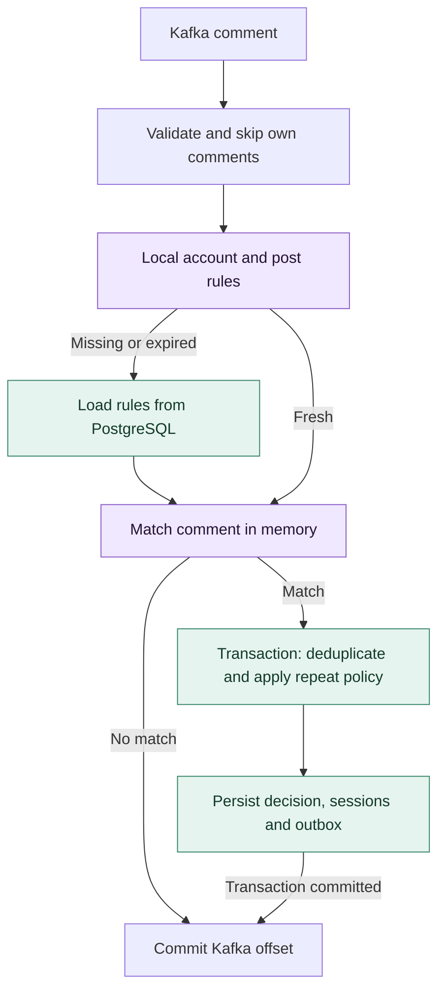
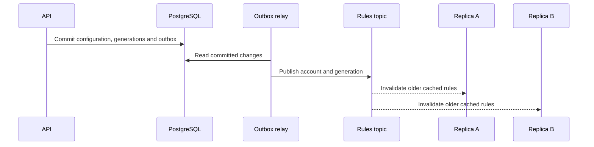

# 002. Trigger matching and caching

> **Implemented:** rule publication, cached matching, durable session admission, and cross-replica invalidation. Sessions remain pending; workflow execution and frontend API integration are the next steps.

[Architecture index](README.md) · [Inbound event contract](001-inbound-comment-events.md)

## Architecture

Most incoming comments will not match an automation. The design therefore avoids database access for comments evaluated against fresh cached rules. PostgreSQL remains authoritative; service replicas are stateless and can rebuild their local caches after a restart.



Own comments are acknowledged without matching. A failed load or transaction is retried without committing the offset. Concurrent processing must never commit past unfinished work in the same partition.

## Rule storage and selection

A trigger contains `scopes[]` (account ID and all/selected posts), `comment` (mode, operator, keyword logic, keywords, exclusions, case sensitivity), and `repeat.mode`. Draft edits do not change live behavior: publishing creates an immutable revision and updates its relational bindings in one transaction.

| Record | Stored structure and purpose |
| --- | --- |
| `automations` | Workspace + automation ID; draft JSON, enabled flag, published revision |
| `automation_versions` | Workspace + automation ID + revision; immutable trigger/workflow JSON |
| `trigger_bindings` | Workspace + account + automation + revision; `all` or `selected` post scope |
| `trigger_posts` | Account + post + automation; selected-post membership |
| `account_rule_sets` | Account + generation; version of the complete account rule set |
| `rule_changes` | Event ID + account + generation; transactional invalidation outbox |

### Database indexes

These are the actual B-tree access paths in the [migration](../../backend/internal/db/migrations/00002_automation_rules.sql), including indexes created by primary keys:

| Lookup | Index / key | Why this order |
| --- | --- | --- |
| Account ownership and platform | `connected_accounts` PK `(id)` | One globally unique internal account ID |
| Account generation | `account_rule_sets` PK `(account_id)` | Direct lookup, including batched version checks |
| All-post rules / existence of selected-post rules | `trigger_bindings_scope (account_id, post_scope)` | Filter by account and scope without enumerating historical posts |
| Rules for a selected post | `trigger_posts` PK `(account_id, post_id, automation_id)` | Account + post form the leading prefix |
| Binding for each selected-post result | `trigger_bindings` PK `(tenant_id, account_id, automation_id)` | Join each post membership to its published revision |
| Immutable rule document | `automation_versions` PK `(tenant_id, automation_id, revision)` | Fetch the exact revision selected by the binding |

The [sqlc queries](../../backend/internal/db/queries/automation.sql) use these access paths to fill caches. There is no SQL text search or JSON index on the per-comment path. An internal bearer-authenticated API registers accounts and manages drafts/publications; its credential belongs to a trusted integration. Workflow JSON is stored for the future executor. See the [API example](../local-development.md#publish-a-trigger).

## Matching a comment

1. Select the account's all-post rules and, only if selected-post bindings exist, that post's rules from the same generation. An empty candidate set returns immediately, without normalizing text.
2. Normalize the comment with Unicode NFC and trim surrounding whitespace. Produce case-preserving/lowercase representations only as needed, once each per comment. Terms and whole-word expressions are prepared when rules enter the cache.
3. Check exclusions first: they always use whole-word matching. Then accept any comment (`mode: any`), or evaluate keywords with short-circuit `any/all` logic.
4. Return each matching automation and immutable revision once. Repeat policy is checked afterward in the admission transaction, since it depends on durable session state.

| Operator | Behavior | Example for `pricing` |
| --- | --- | --- |
| `exact` | Entire normalized comment equals the term | `PRICING` matches when case-insensitive; `pricing?` does not |
| `contains` | Literal substring | `repricing` matches |
| `whole_word` | Literal word/phrase with Unicode boundaries; flexible whitespace between phrase words | `pricing?` matches; `repricing` and `pre_pricing` do not |

Letters, numbers, combining marks, and `_` are word characters. User terms are escaped, not interpreted as regular expressions. Go and the editor run the same [Unicode fixtures](../../frontend/src/feature/automation/model/testdata/matching.json).

## A bounded, demand-loaded cache

| Entry | Key | Contents |
| --- | --- | --- |
| Account rules | Globally unique internal account ID | Generation, compiled all-post rules, whether selected-post rules exist |
| Post rules | Account ID + generation + post | Compiled rules for that selected post, or a known-empty result |

Connected-account IDs are globally unique and bound to one workspace and platform. The account snapshot resolves tenant ownership, so the existing Kafka payload needs no tenant field or per-comment ownership query. The internal integration supplies post IDs qualified by account; platform catalog verification is outside this API.

The in-memory index is a hash map with a doubly linked LRU list: lookup and recency updates are expected O(1). Cached snapshots contain compiled predicates and revision IDs. An additional per-account entry map lets invalidation visit only that account’s cached posts.

Separating account and post entries prevents traffic on a popular account from keeping every historical post in memory. A year-old post's rules are loaded again when a new comment arrives. All-post rules are stored once per account. Account and post snapshots used together must have the same generation.

| Decision | Reason |
| --- | --- |
| Load only on demand | Avoid retaining rules for inactive accounts and posts |
| Idle TTL | Remove entries unused by comment traffic; configured initially at 20 minutes |
| Separate freshness deadline | Frequent hits must not keep outdated rules valid indefinitely; initially 60 seconds, 15 seconds for empty results |
| Weighted memory limit with LRU eviction | TTL alone cannot bound memory during traffic spikes; initially 64 MiB per replica |
| Cache empty results | Repeated irrelevant traffic should not repeatedly query PostgreSQL |
| Per-key `singleflight` and bounded concurrent fills | Prevent concurrent misses from overwhelming the database |
| Backend limit of 100 non-deleted automations per workspace | Bound configuration growth, including drafts and disabled automations |

Validation also limits each trigger to 32 keywords and 32 exclusions, 256 bytes per term, 20 accounts, and 1,000 selected posts; each document is at most 256 KiB. Empty entries and cache metadata count toward the memory budget. Cleanup releases idle entries even without another lookup; background refresh does not extend their idle lifetime. Freshness-expired entries must be revalidated before use. Load errors are never cached as empty results.

Local cache hits require no network round trip. Redis is deferred: a shared second-level cache is justified only if measurements show excessive duplicate fills across replicas.

## Why the hot path is fast

A fresh cached non-match performs **zero PostgreSQL or Redis calls** in the comment handler. Known-empty accounts skip both post lookup and text evaluation. Otherwise, the matcher scans only the selected account/post's candidates, with terms already prepared. At most 100 automations belong to a workspace; text evaluation still grows with candidate count, term count, and comment length—it is not O(1).

Local microbenchmarks on Apple M3 Max, Go 1.26.5, darwin/arm64 (2026-11-04):

| Benchmark | What is measured | Time per operation | Heap allocations |
| --- | --- | --- | --- |
| `BenchmarkCachedNonmatch` | Warm account cache with no rules | ~75 ns | 0 |
| `BenchmarkPredicate` | Two compiled whole-word terms rejecting a short, already-normalized comment | ~2.34 µs | 0 |

Reproduce from `backend`:

```sh
go test ./internal/feature/matching -run '^$' -bench 'Benchmark(CachedNonmatch|Predicate)$' -benchmem
```

These measure individual operations, not end-to-end throughput or tail latency under contention. Kafka decoding/commits, cache fills, background version checks, and session transactions are outside these timings. The main architectural saving is removing database work from the frequent fresh-cache rejection path.

## Changes across replicas

Publishing, disabling, deleting, or changing scope updates bindings, advances affected account generations, and writes an outbox event in one transaction. The outbox prevents a committed configuration change from losing its notification if the publisher crashes.



Each replica reads every partition of `automation.rules` without a consumer group. Startup captures log-end offsets before accepting comments; restarts begin with an empty cache. A shared consumer group would distribute invalidations instead of broadcasting them. Topic partition changes require a restart; periodic version checks remain the fallback. Duplicate or reordered notifications are harmless because generations only advance. Invalidation includes empty results, and an in-flight load cannot reinstall an older generation. Cold accounts are not loaded in response to notifications.

Bounded background reconciliation checks generations of resident accounts to recover from missed notifications. The freshness deadline limits how long an unvalidated snapshot can be used. Configuration propagation is **eventually consistent**: a comment may use the previous generation during that window, including a negative result. Saving a rule does not promise instantaneous activation on every replica.

## Deduplicate after matching

To avoid writes for irrelevant traffic, the consumer acknowledges non-matches without inserting `processed_comments`. Compared with the original ingestion-only implementation, a redelivered non-match can match after rules change.

For matching comments, one transaction records the event decision, applies repeat policy, creates pending sessions, and writes `SessionRequested` commands to `session_outbox`. These commands are not dispatched yet. The [event identity](001-inbound-comment-events.md#idempotency-key) prevents duplicate starts. Record outcomes for all matching automations, including repeat-policy denials, so a committed decision cannot gain new starts on redelivery.

Repeat policy is enforced through database constraints or atomic reservations, never cached session state:

- `every`: allow each distinct matching comment.
- `once`: one start per automation, account, and participant, across posts and revisions.
- `skip_active`: reject another start in that scope while a session is active, including waiting for a reply or timer.

This keeps admission correct across replicas. Coordinating competing automations waiting on the same DM conversation remains a separate execution-model decision.
