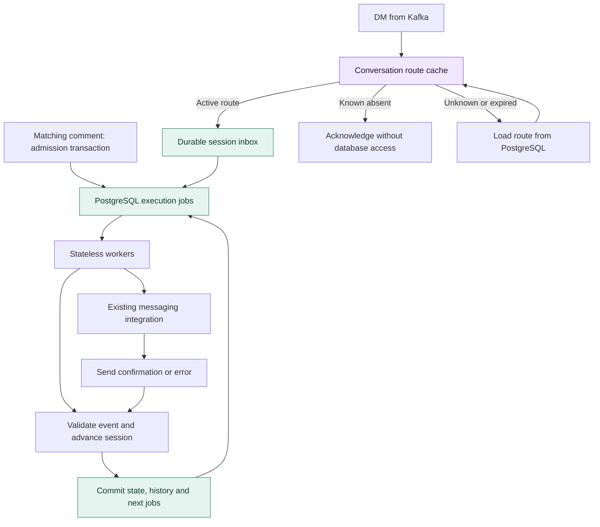
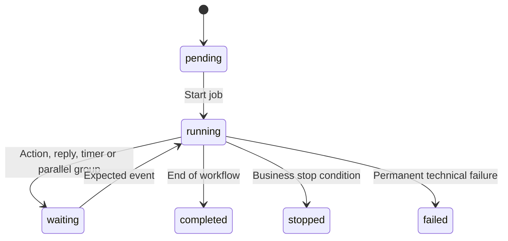
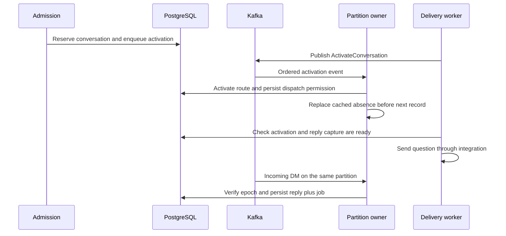

# 003. Session execution and DM routing

> **Implemented:** durable session execution, asynchronous delivery, reply waits, timers, and partition-scoped DM caching. Local configuration records sends in PostgreSQL; real sends use the HTTP integration contract below. The React editor is connected to the backend API.

[Architecture index](README.md) · [Trigger matching](002-trigger-matching-and-cache.md) · [Inbound events](001-inbound-comment-events.md)

## Execution model

Use a PostgreSQL-backed state machine and stateless workers. Waiting sessions retain database records, not goroutines, connections, or open transactions. The existing Kafka stream carries external events and conversation activation; PostgreSQL schedules internal work so a state change and its next job commit atomically.

Publication stores an immutable compiled `execution_plan` beside the `automation_versions` document. It contains steps, transitions, and pinned email-template snapshots (`revision`, `subject`, `body`); changing a draft or template cannot change an existing session. A session stores one execution of that document. Publishing validates step IDs, supported types, reachable transitions, and availability of an email address on every path leading to an email action.

Keep the current editor's scope: sequences, parallel actions, reply waits, delays, schedules, and timeout branches. No arbitrary cycles. A timeout branch replaces the remaining main sequence and terminates independently. Re-asking for an email repeats an operation within a wait, not the workflow graph.

## States and data model

Any active session may also become `cancelled` by explicit request. A timeout or invalid-answer limit is a normal `stopped` outcome, not a technical failure. `running` means executable work exists; a worker's lease, not session status, establishes ownership of a job.

| Record | Fields and responsibility |
| --- | --- |
| `automation_sessions` | Existing identity/revision fields plus `current_node_id`, `context jsonb`, `version`, `finish_reason`, timestamps; context includes `contact.email` |
| `session_steps` | `session_id`, `node_id`, `parent_node_id`, `status`, `wait_kind`, `listen_from_sequence`, `deadline_at`, `invalid_attempts`, `output`; runtime state for each step and parallel child |
| `session_inbox` | Provider event identity, `session_id`, `conversation_epoch`, `sequence`, `accepted_at`, `payload`, `consumed_at`; durable incoming replies |
| `conversation_owners` | `account_id`, `participant_id`, nullable `session_id`, `epoch`, `next_sequence`, activation state; reservation and routing identity for a conversation |
| `execution_jobs` | `id`, `session_id`, `node_id`, `logical_key`, `kind`, `status`, `run_at`, `lease_until`, `lease_token`, `attempt`, `payload`, `result`; transitions, delivery, activation publication, and wakeups |
| `session_transitions` | `session_id`, `version`, `node_id`, `event_id`, old/new state, reason, timestamp; diagnostic history, not the source of truth |

Migration 00003 replaces `session_outbox` with `execution_jobs`, preserving existing start records. Legacy versions are compiled on execution; an invalid legacy workflow fails explicitly. Keep the active-session scopes used by repeat admission. Steps distinguish armed reply capture from active waiting; delivery retry attempts and invalid user replies have separate counters.

| Access path | Index / constraint |
| --- | --- |
| Step identity | `session_steps` PK `(session_id, node_id)` |
| Conversation ownership | `conversation_owners` PK `(account_id, participant_id)` |
| DM deduplication | UNIQUE `(account_id, conversation_id, provider_message_id, event_type)` |
| Pending replies | `session_inbox (session_id, sequence) WHERE consumed_at IS NULL` |
| Logical job deduplication | UNIQUE `(session_id, logical_key)` |
| Ready work and expired leases | Separate partial indexes on `(run_at, id) WHERE status = 'ready'` and `(lease_until, id) WHERE status = 'leased'` |
| Transition identity | UNIQUE `(session_id, version)` |

Tenant ownership is inherited from the session and registered account and enforced on writes. Postgres queries and migrations continue to use sqlc and Goose.

## Worker algorithm and recovery

1. Each worker claims one due job with `FOR UPDATE SKIP LOCKED`; set a lease deadline and increment its fencing token, then commit.
2. For a transition, lock the session and verify the expected node, event, and job token. Operations involving conversation ownership always lock the conversation before the session.
3. Atomically update step/session state, consume the triggering input, append transition history, finish the job, and create subsequent jobs. Duplicate inputs and obsolete wakeups cannot advance a completed step again.
4. Send external requests outside database transactions. Persist the integration's result in a separate guarded transaction; merely enqueueing a command is not successful delivery.

Expired leases return internal jobs and idempotent sends to the ready queue; non-idempotent sends become `unknown`. Every result write checks the lease token and its deadline; a former worker cannot overwrite a newer attempt. The session lock serializes transitions across workers and instances. Cancellation stops pending work, but cannot undo an external request already in flight.

## Reply waits, timers, and parallel actions

| Step / event | Transition |
| --- | --- |
| `reply`, `dm`, `email` | Enqueue a delivery job and wait for confirmation |
| `parallel` | Enqueue independent child actions; continue only after all succeed; retry only unsuccessful actions |
| Valid reply | Consume the DM once, store the output, complete the wait, and advance |
| Invalid email reply | Increment `invalid_attempts`; re-ask or stop according to policy and limit; preserve the original deadline |
| Reply timeout | Stop, send the configured final DM then stop, or enter the terminal timeout branch |
| `delay` / `schedule` | Compute and persist UTC `run_at` once; continue when its wakeup becomes due |

A reply wait references its question through `prompt_node_id`. Arm capture and record its sequence boundary before dispatching that question. Replies arriving while other actions in a parallel group finish stay in the inbox. Activate the wait's deadline when execution reaches the wait; consume eligible buffered replies before sleeping. When supplied, `reply_to_message_id` must identify the question or one of its re-asks. A reply that arrives before an outstanding re-ask receipt stays buffered until its send outcome is known.

Email extraction accepts one unambiguous syntactically valid address from natural text; multiple addresses are invalid. This does not verify mailbox ownership. A retry message has its own logical job key; it does not reset the response window.

**Reply versus timeout:** use the database acceptance time, not the platform's `occurred_at`. The inbox writer assigns sequence/time under the conversation lock. Before closing an expired wait, process eligible unconsumed messages accepted before its deadline, in sequence order. The timeout transition takes the same locks. A webhook accepted after closure cannot revive the wait.

Schedules retain their IANA timezone and computed UTC instant. Match the editor: a past fixed date continues immediately; the next wall-clock occurrence handles repeated hours and skips a nonexistent occurrence. Recovery never restarts a delay from the recovery time.

## DM routing cache and activation barrier

DM traffic can be mostly unrelated to automations. Use a bounded local LRU cache keyed by `(account_id, participant_id)`, containing either `{session_id, conversation_epoch}` or a known-absent route. Each partition processes records and cache fills sequentially, bounding concurrent loads by the assigned partition count. The configurable 8 MiB per-instance budget is divided among assignments; positive entries have 20-minute idle TTL and 60-second freshness, negative entries expire after 15 seconds. Empty entries count toward the budget, and idle maintenance physically removes expired entries.

| Cache result | Processing |
| --- | --- |
| Known absent and fresh | Ignore the unrelated DM and acknowledge Kafka without PostgreSQL access |
| Active route | Transactionally verify owner/epoch, deduplicate, and persist the DM with its processing job |
| Missing or expired | Load from PostgreSQL and cache the result |
| Load failure | Retry without acknowledging; never interpret the failure as absence |

Do not cache mutable step state or use a cached route to authorize a transition. A stale positive causes invalidation and routing retry for the same message. Unrelated messages do not enter the session inbox; its deduplication protects routed messages, not a permanent history of every DM.

**Negative caching requires stronger ordering than trigger-rule caching.** Asynchronous invalidation alone can discard an immediate answer: a question has been sent, but another instance still remembers that no session exists. TTL does not close that race.

The activation publication job is durable and retryable. Route readiness and reply capture must both be established before the prompt job becomes dispatchable. If the process crashes between the database commit and local cache update, replay must refresh the cache even for an already-applied activation; a new partition owner starts cold.

Required ordering contract:

- `CommentReceived`, `ActivateConversation`, and `MessageReceived` events share the same topic and serialized `(platform, account_id, participant_id)` key, with sequential handling per conversation. DMs carry stable message/conversation IDs, canonical participant identity, text, and optional reply-to identity.
- Every route activation uses this ordered path; an arbitrary worker's database write cannot bypass it. Ignore stale activation epochs and events for terminal sessions.
- Cache entries and in-flight fills belong to the current partition assignment. On revocation, fence old work and discard that assignment's cache; on reassignment, start empty. A stable partitioning scheme is required; changing it needs a coordinated routing migration.
- The consumer creates readers and route caches per Kafka generation and partition, handles records sequentially, and commits offsets through that generation. Revocation cancels handlers and retires the cache. The next assignment creates a new empty cache.

These guarantees make a known-absent cache result safe for the reply window. TTL handles memory and freshness, not activation correctness. Active replies still require durable writes, while fresh-cache unrelated DMs avoid database work.

## Conversation policy and external delivery guarantees

Reserve one reply-capable session per account/participant until it reaches a terminal state. A conflicting launch records `conversation_busy`. When several automations match, choose by descending `priority` (default 0), then ascending automation ID. This is an additional admission rule even for repeat mode `every`; it prevents one reply from advancing several competing workflows. Older inbox messages are never automatically reassigned to a new session.

Use a stable idempotency key for each logical send. Delivery retries keep that key; a new re-ask after another invalid reply gets a new one. Transient failures retry with bounded backoff, respecting integration retry guidance. A permanent error or exhausted retry budget fails the session; a parallel group's already-successful sends are not repeated or rolled back.

Database fencing does not guarantee exactly-once external delivery. If a request might have succeeded but its acknowledgement was lost, use integration-supported idempotency or result reconciliation. Without either, retain an unknown delivery outcome for reconciliation rather than blindly resending; the session remains waiting. This integration contract is required before enabling real sends.

## Delivery boundary and operations

`delivery.mode: recording` persists immutable requests in `recorded_deliveries` and returns a local receipt; it sends nothing to social networks or email providers. Set `mode: http`, `url`, and optional bearer `token` to connect the existing messaging service. Set `idempotency: true` only if that service deduplicates the key durably.

The adapter POSTs JSON with `idempotency_key`, `kind` (`reply`, `dm`, `email`), account/participant/platform identity and the rendered message. Replies also carry post/comment identity; email includes `email` and `subject`. The same key is sent in `Idempotency-Key`. A successful response is `{"status":"succeeded","provider_message_id":"…"}` after the actual send. Explicit `retry`/`failed` responses guarantee no send occurred. HTTP 202, transport failure, malformed receipts, and 5xx are uncertain outcomes: retry only with idempotency; otherwise retain `unknown`. `retry_after` is a JSON duration in nanoseconds; HTTP 429 also supports integer `Retry-After` seconds.

The internal bearer-protected API exposes `GET /v1/workspaces/{tenant}/sessions/{id}` (state, steps, jobs, history), `POST …/cancel`, and `POST …/resolve-delivery`. Resolution accepts `job_id`, `status` (`succeeded` or `failed`), optional `reason`, and a required `provider_message_id` for success. Resolve only after checking the integration's outcome; the update and resumed transition commit together.

Integration tests cover early replies, invalid answers, reply/timeout ordering, worker restart, concurrent workers, stale leases, unknown outcomes, cancellation, conversation contention, and activation after a two-consumer Kafka rebalance. See the [runnable example](../local-development.md).

## Editor integration

The editor uses a same-origin workspace proxy; the internal API token stays server-side. `GET …/automations`, `GET …/catalog`, and template CRUD supply persisted workspace data. Catalog metadata is populated by the existing social integration, not inferred from comment traffic.

Drafts may be incomplete. Publication validates them and creates an immutable executable version. Draft `If-Match` preconditions and template revisions reject stale writes across tabs/replicas; the existing workspace lock serializes mutations and limits. Publication resolves current template records under that lock and pins their contents before committing. Saving a draft or changing a template cannot alter a running session. Pausing or deleting a flow stops new admission and preserves existing sessions.
